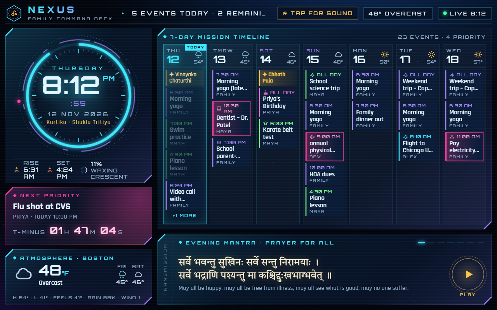
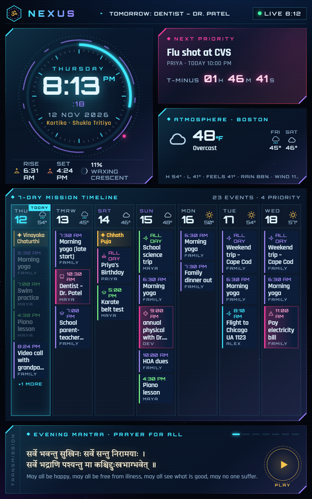
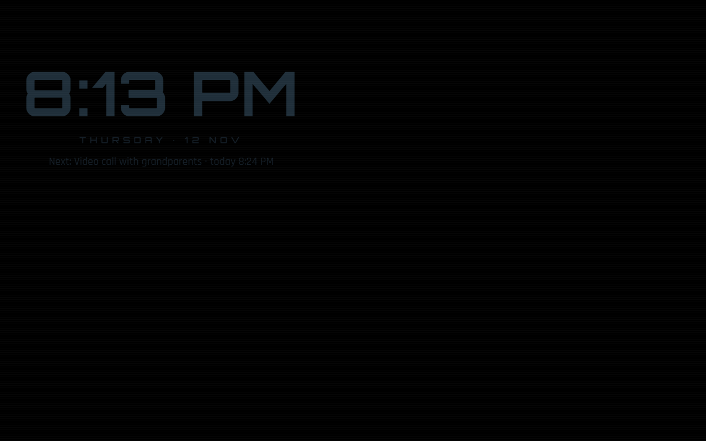
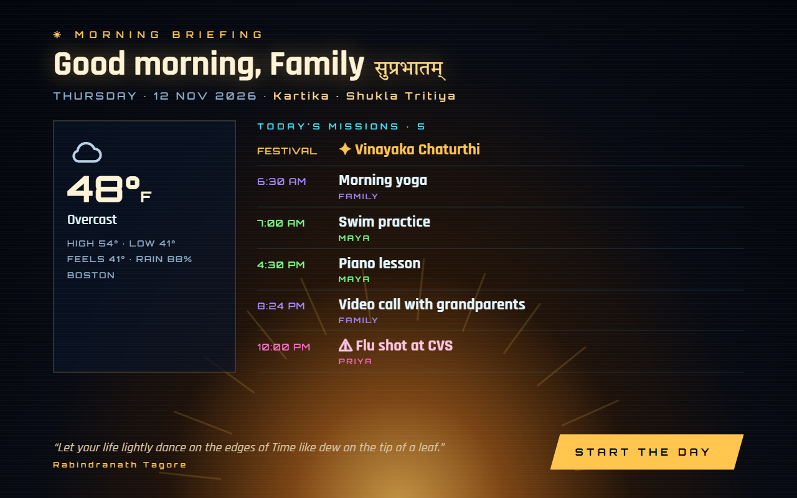
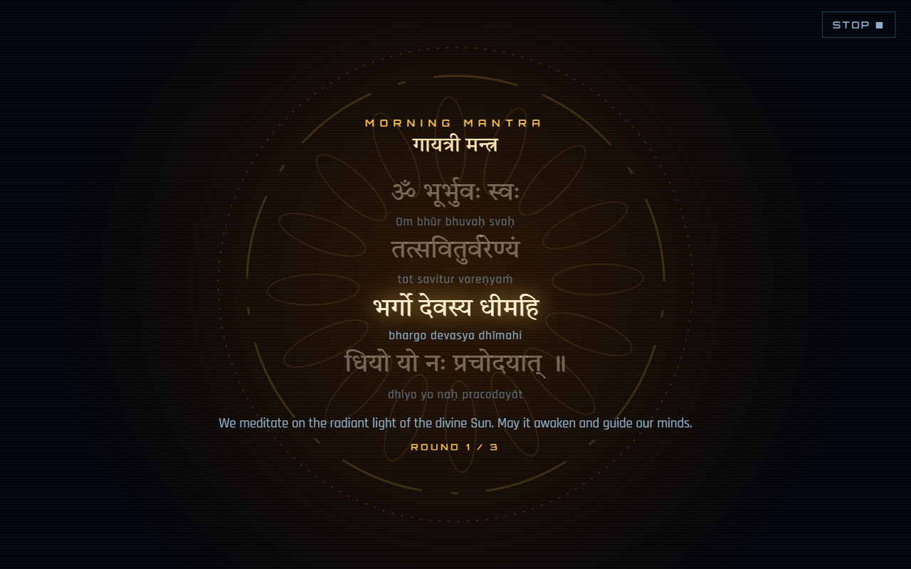
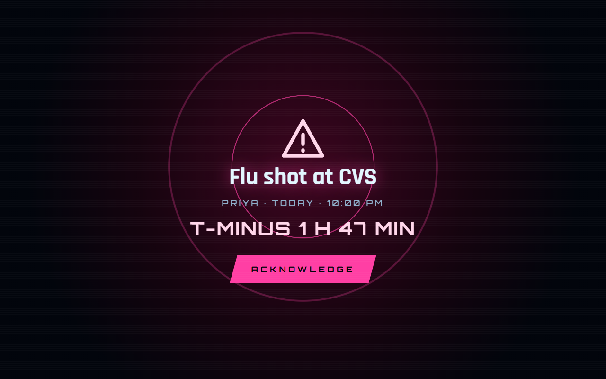
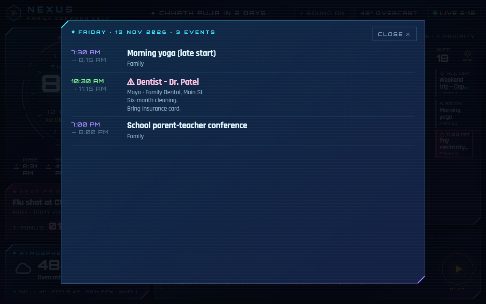
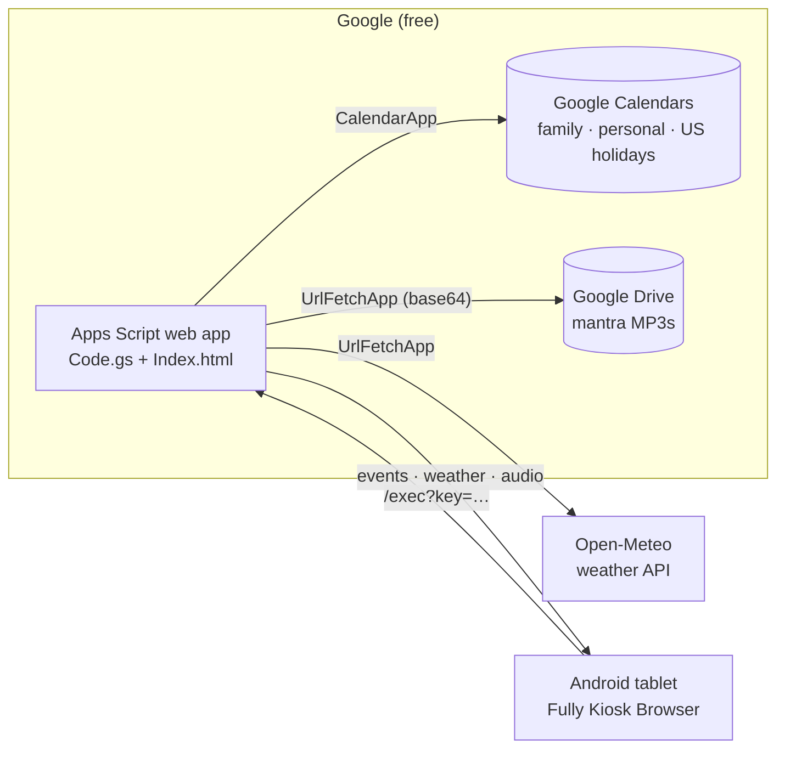

<div align="center">

# ⬡ NEXUS · Family Command Deck

**A futuristic, always‑on family calendar for an old Android tablet: week timeline, doctor reminders, live weather,<br>Hindu festivals computed from a built‑in Panchang engine, and Sanskrit mantras that chant on schedule.**




</div>

---

## Why

An old tablet in a drawer makes a great family hub, but it can't run modern apps, and its outdated certificates break most websites.
NEXUS turns it into a dedicated wall display that just works:
- The whole UI is **one self‑contained HTML file** that renders on Android 6's web view.
- The data comes from a **free Google Apps Script** web app, so the tablet only ever talks to Google.

## ✨ Highlights

| | |
|---|---|
| 🗓️ **7‑day mission timeline** | Every event from your Google Calendars, colour‑coded per person, with daily weather. Tap a day for full details. |
| 🩺 **Priority alerts** | Doctor, dentist and other `!` events get a full‑screen alert with chime 24 h, 3 h and 1 h before, plus a live T‑minus countdown. |
| 🪔 **Panchang engine** | Tithi, lunar month, Adhik Maas and 40+ Hindu festivals, calculated on the device from real Sun and Moon positions for *your* city. No India feed needed. |
| 🇺🇸 **US holidays** | Read from Google's holiday calendar, with an "Upcoming US holiday" countdown card. |
| 🕉️ **Mantras that chant** | Morning and evening Sanskrit mantras with neural‑voice recordings, tanpura drone and bells. Lines light up in sync, and they play on schedule. |
| ☀️ **Morning briefing** | At 7:15 a sunrise card with a chime shows the greeting, weather, today's events and the next priority. Tap the clock to see it any time. |
| 🌦️ **Live weather** | Current conditions, a 7‑day forecast, sunrise/sunset and moon phase (Open‑Meteo, fetched by Google). |
| 🌙 **Night mode** | A dim, drifting clock overnight. Tap to peek at the full dashboard. |
| 🔄 **Follows the tablet** | Landscape layout when the tablet stands sideways, a dedicated portrait layout when it's upright. Switches instantly on rotation. |
| ⚡ **Fast sync** | Calendar edits appear within about 2 minutes. Tap the logo to sync immediately. |
| 🎲 **Transmission panel** | A rotating card: mantra, quote and message of the day, festival countdowns, fun fact and riddle. |
| 🔒 **Private by design** | Key‑protected web app, settings in your Google account, and no personal data in this repo. |

## 📸 Screens

| Portrait (tablet upright) | Night mode |
|---|---|
|  |  |
| **Morning briefing** | **Mantra player** |
|  |  |
| **Priority alert** | **Day detail** |
|  |  |

<sub>Screenshots use the sample family from <code>src/config.example.json</code>. Regenerate them with <code>python tools/screenshots.py</code>.</sub>

## 🧭 How it works



- **Frontend** (`src/dashboard.html`): plain HTML, CSS and JavaScript, no framework, no build step. It renders a 960×600 stage (600×960 when upright), scaled to any screen, and includes:
  - an iCalendar parser with RRULE expansion;
  - the Panchang astronomy (Meeus algorithms, Lahiri ayanamsa);
  - Web Audio chimes and drone, and the mantra player.
- **Backend** (`src/Code.template.gs`): a small Apps Script that reads your calendars and proxies the weather and the mantra audio. The tablet's old web view can't reach modern certificates or play Drive links, so everything goes through Google.
- **Access**: deployed as *Anyone*, because kiosk browsers can't do a Google sign‑in. Every page and data call needs the family access key generated at build time.

## 🚀 Quick start

```bash
git clone <this repo> && cd Nexus-Family-Dashboard
python tools/build.py                          # creates src/config.local.json + access key
# edit src/config.local.json (family, city, calendars), then build again:
python tools/build.py                          # → dist/Code.gs + dist/Index.html
```

1. Paste `dist/Code.gs` and `dist/Index.html` into a new [Apps Script](https://script.google.com) project, run `testSetup`, and **Deploy → Web app**.
2. Open `https://script.google.com/macros/s/…/exec?key=<access-key.txt>` on the tablet, ideally in Fully Kiosk Browser, full screen.

The full walkthrough covers Google setup, the tablet, lock‑down, calendar sharing and troubleshooting: **[docs/SETUP.md](docs/SETUP.md)**.

## ⚙️ Configuration

All settings live in `src/config.local.json` (git‑ignored). Start from [`src/config.example.json`](src/config.example.json).

| Key | What it does |
|---|---|
| `members` | Name, colour and title keywords per person (`[Maya] Dentist`, `Dev: physical`). |
| `calendars` | Google Calendar IDs to show; `name` is a member (colours the whole calendar) or `Family`. |
| `city`, `units` | Location for weather and the Panchang; `F` or `C`. |
| `importantKeywords` | Words that make an event a priority (doctor, dentist, vaccine…). |
| `reminderMinutes`, `headsUpMinutes` | Alert stages (default 24 h / 3 h / 1 h) and the heads‑up toast. |
| `mantraAudio` | Google Drive share links for the recordings in `audio/`. |
| `mantraAutoplay`, `morningBriefing` | Schedule (default 06:30 / 19:00, briefing 07:15). |
| `nightMode` | Dim clock window, e.g. `{"start":"22:30","end":"05:30"}`, or `null` to stay bright. |
| `refreshMinutes` | How often the tablet re‑reads the calendars (default 2). The server caches for 1 minute. |

### Event naming

| You type in Google Calendar | The dashboard shows |
|---|---|
| `[Maya] Dentist` or `Maya: Dentist` | Maya's colour, tooth icon, priority alerts |
| `Dev annual physical` | Dev's colour (name found in the title), priority |
| `!Pay electricity bill` | `!` prefix = priority, with alerts |
| `Priya's Birthday` (all‑day, yearly) | cake icon |

## 🪔 The Panchang engine

The dashboard computes the Hindu calendar itself, for your coordinates:
- Sun (Meeus ch. 25) and Moon (table 47.A) positions, with the Lahiri ayanamsa.
- Amanta months, including **Adhik Maas**, plus kshaya and vriddhi tithis.
- Each festival uses its traditional time of observance: sunrise, noon, aparāhna, pradosh, moonrise or midnight. **Bhadra** is avoided for Raksha Bandhan and Holika Dahan.

Checked against India's official 2026–27 dates (computed for New Delhi), it matches:
- Diwali, Holi, Dussehra, Navratri;
- Janmashtami, Ganesh Chaturthi, Raksha Bandhan;
- Maha Shivaratri, Ram Navami, Karva Chauth, Chhath and more.

Outside India some dates fall a day earlier, exactly as on local temple calendars, because the tithi changes at a different local time.

## 🕉️ Mantra recordings

`audio/` holds 8 ready‑made recordings: Gayatri, Karāgre, Vakratuṇḍa, Asato Mā, Saha Nāvavatu, Śubhaṁ Karoti, Mahāmṛtyuñjaya and Sarve Bhavantu. Each one is:
- read by a neural female voice;
- mixed with a tanpura drone, temple bells and reverb by [`tools/make_mantras.py`](tools/make_mantras.py);
- paired with per‑line timings (`audio/marks.json`), so the text highlights in sync.

You can swap in any real recording (a purchased track, or family members chanting); the player handles both.

## 🛠️ Development

```bash
python tools/devserver.py              # local preview with sample events → http://localhost:8787
adb reverse tcp:8787 tcp:8787          # …and on a USB-connected tablet
python tools/build.py                  # rebuild dist/ for Apps Script
python tools/screenshots.py            # regenerate docs/screenshots (needs Chrome/Edge + websocket-client)
python tools/make_mantras.py           # regenerate audio/ (needs edge-tts numpy miniaudio lameenc)
```

```
├── src/
│   ├── dashboard.html          # the whole frontend → dist/Index.html
│   ├── Code.template.gs        # Apps Script backend template → dist/Code.gs
│   └── config.example.json     # sample settings (copy → config.local.json)
├── audio/                      # mantra MP3s + line timings
├── tools/                      # build, preview server, screenshots, mantra generator
└── docs/                       # setup guide, screenshots, tablet notes
```

> **Apps Script gotcha:** HtmlService strips comments from HTML files with a scanner that also eats `//` inside strings. So the frontend writes URLs as `'https:\/\/…'` and uses a string placeholder (`"__RUNTIME_CONFIG__";`) for config injection.

## 🔐 Security & privacy

- **Kept out of git:** `access-key.txt`, `src/config.local.json` and the generated `dist/`, which contain your key, calendar IDs and Drive links.
- **The web app** refuses the page and every data call without the key. Treat the tablet link like a password.
- **Audio proxy:** the script only proxies Drive files listed in your own `mantraAudio`.
- **Lock‑down:** Android screen pinning plus a screen lock keeps the kiosk in place. See [SETUP › Locking it down](docs/SETUP.md#-locking-it-down).

## 🙏 Acknowledgements

- [Open‑Meteo](https://open-meteo.com): free weather API.
- Jean Meeus, *Astronomical Algorithms*: Sun and Moon positions.
- [Fully Kiosk Browser](https://www.fully-kiosk.com): the kiosk shell on the tablet.
- Microsoft neural voices via [edge‑tts](https://github.com/rany2/edge-tts): the mantra recordings.
- Fonts: Orbitron, Rajdhani and Tiro Devanagari Sanskrit (Google Fonts).

## 📄 License

[MIT](LICENSE)
